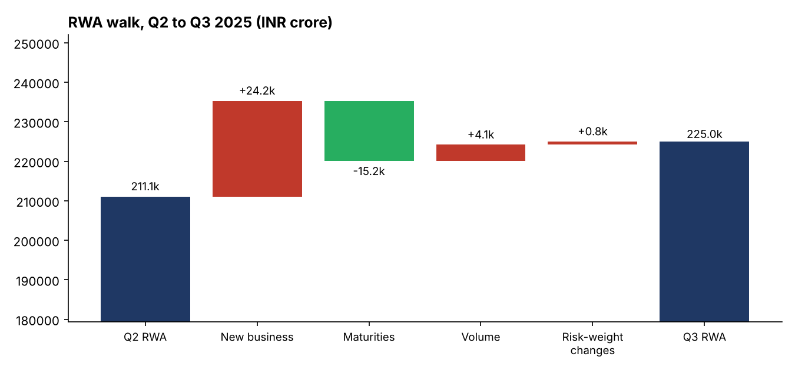
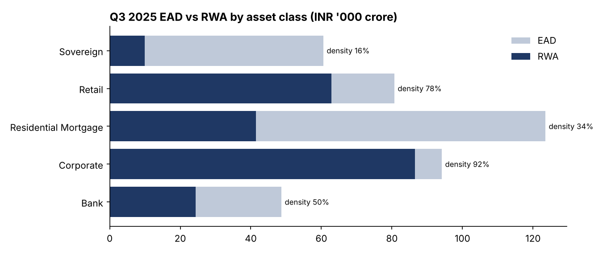

# Basel III RWA Calculator

A credit risk-weighted assets (RWA) calculator built on the **Basel III standardised approach**. It runs both as a Python engine and as a live Excel model, and the two reconcile to the paisa. It prices a bank's exposure book at two quarter-ends, then explains *why* RWA moved, breaking the change into new business, maturities, volume and risk-weight effects. That breakdown is the core of quarterly capital reporting.



## What it covers

| Step | Rule used |
|---|---|
| Exposure at default | `EAD = drawn + CCF × undrawn`, with CCFs from CRE20.94 (10% cancellable, 20% trade LCs, 40% other commitments, 100% guarantees) |
| Sovereigns | Rating-based risk weights, 0% to 150% (CRE20.7) |
| Banks | External credit rating approach (ECRA), 20% to 150%; unrated banks treated as grade B under the standardised credit risk assessment approach (SCRA), 75% (CRE20.18-21) |
| Corporates | 20% / 50% / 75% / 100% / 150% by rating, 100% if unrated (CRE20.42) |
| Retail | Regulatory retail at 75% (CRE20.65) |
| Residential mortgages | Loan-to-value bands from 20% (LTV ≤ 50%) up to 70% (LTV > 100%) (CRE20.82) |
| Defaulted exposures | 150% if specific provisions are below 20% of the outstanding, otherwise 100% |
| Capital | 8% minimum total capital on RWA |

The rules live in one place (`rwa/rules.py`) with the Basel paragraph numbers next to them.

## The quarter-on-quarter walk

For every exposure that exists at both quarter-ends:

- **Volume effect** = (EAD now − EAD before) × old risk weight
- **Risk-weight effect** = EAD now × (new risk weight − old risk weight)

New deals and matured deals are booked at their own RWA. Added up, the walk lands exactly on the actual Q3 number (the `check` column is zero on every row), which is what makes it usable for explaining movements to a capital committee.

## Results (synthetic book, 1,500 → 1,560 exposures, INR crore)

| | Q2 2025 | Q3 2025 | Change |
|---|---|---|---|
| EAD | 3,78,248 | 4,07,327 | +7.7% |
| RWA | 2,11,075 | 2,25,007 | **+13,932 (+6.6%)** |
| RW density | 55.8% | 55.2% | |
| Capital requirement @ 8% | 16,886 | 18,001 | +1,115 |

What drove the +13.9k RWA:
- **+24.2k new business**, offset by **−15.2k maturities**
- **+4.1k volume**, as existing balances grew about 2%
- **+0.8k risk-weight changes** net, which hides three opposing moves:
  - corporate downgrades from a sector stress: **+926**
  - new retail defaults moving to 150%: **+1,248**
  - mortgage LTVs falling as loans amortise: **−1,369**



## The Excel model

`output/basel_rwa_calculator.xlsx` is a working model, not a dump of results:

- **Parameters.** Every risk weight, CCF, LTV band and the capital ratio is an input cell (blue, with the main levers in yellow). Change one and the whole book reprices.
- **Q2 / Q3 Exposures.** About 3,000 rows of inputs. CCF, EAD, rating bucket, risk weight, RWA and capital are all formulas (`INDEX/MATCH`, `COUNTIF` for LTV bands, nested `IF` for the asset-class logic).
- **Q3 Exposures** also looks up each deal's Q2 EAD and risk weight to work out its walk components.
- **RWA Summary.** `SUMIFS` by asset class, plus the Python engine's numbers alongside. The difference column is zero on every row.
- **QoQ Walk.** The movement breakdown with a self-check and a driver chart.

29,000+ formulas and zero errors, checked by recalculating the workbook in LibreOffice.

## Run it

```bash
pip install -r requirements.txt
python run.py      # generate book -> Python engine -> Excel model -> charts
pytest -q          # 15 tests: risk-weight tables, LTV boundaries, defaults, CCF, walk reconciliation
```

## Simplifications

This is a learning model, not a regulatory engine. It leaves out credit risk mitigation (collateral, guarantees), counterparty credit risk (SA-CCR), short-term rating tables, specialised lending, and the output floor. Retail and mortgage lines are pooled segments, not single loans. All data is synthetic.

## Tech

Python (pandas, NumPy), Excel (openpyxl-built model with INDEX/MATCH, SUMIFS, COUNTIF), matplotlib, pytest.
Reference: [Basel Framework, CRE20](https://www.bis.org/basel_framework/chapter/CRE/20.htm).
